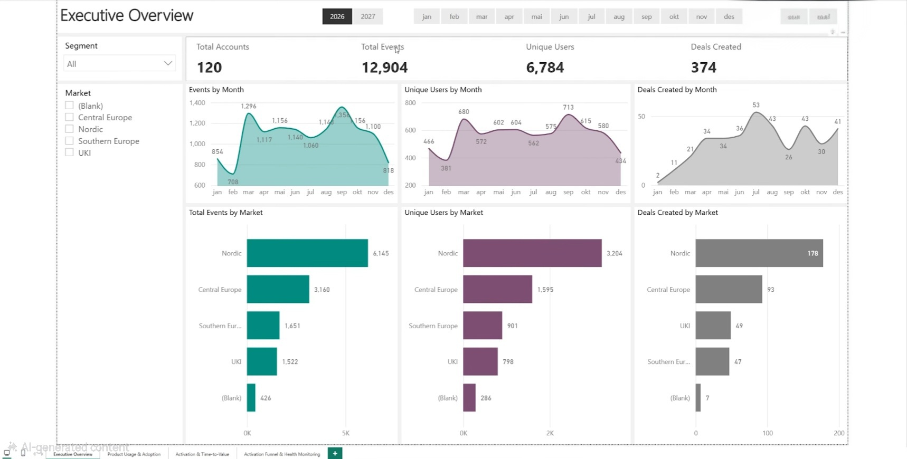
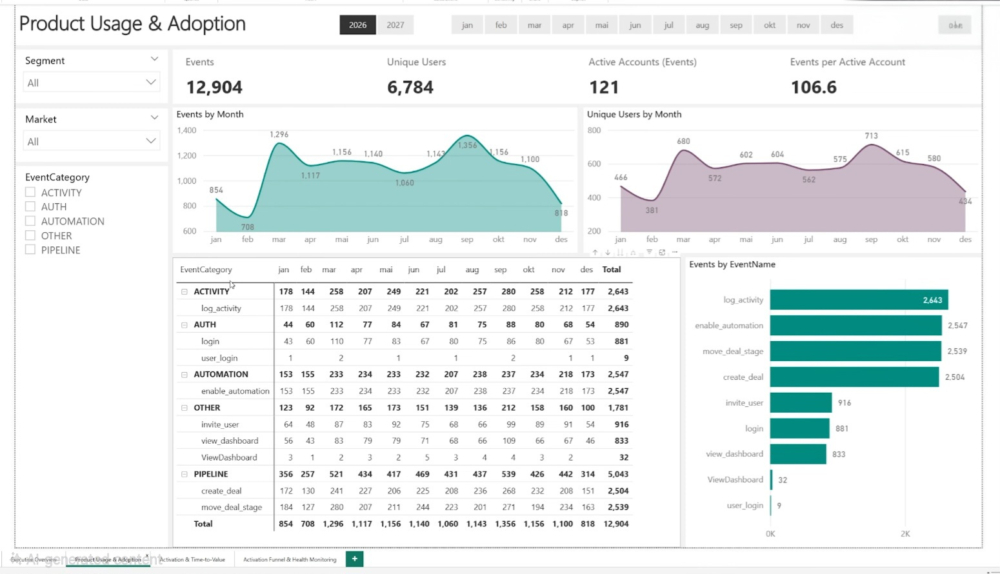
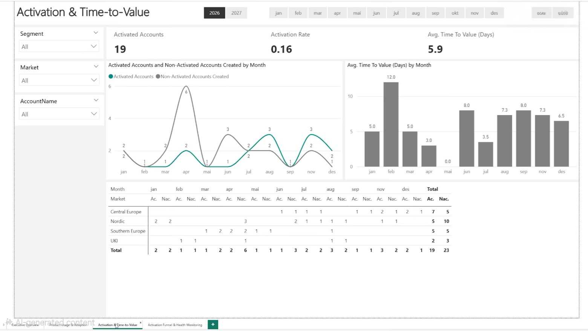
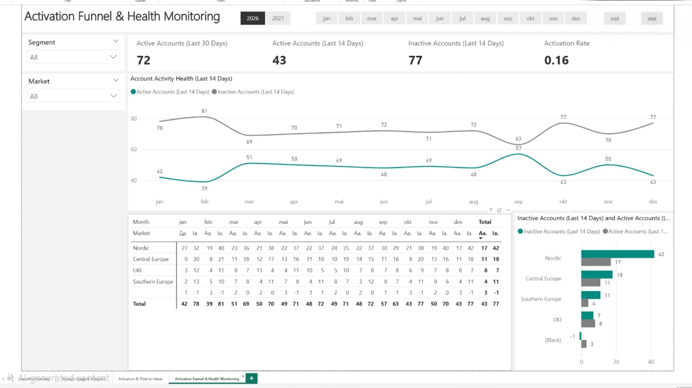

# PulseIQ — SaaS Product Analytics & Product Decision Intelligence

**One line:** A completed fictional B2B SaaS CRM **case study** — reproducible medallion pipeline, metric contracts, Gold product analytics, product decision intelligence, and Power BI reporting assets.

> **Synthetic data only.** PulseIQ does not describe real customers, revenue, deployments, or experiment results. All KPIs are illustrative.

PulseIQ **began as a SaaS Product Analytics Platform** (medallion ETL, dimensional models, activation KPIs, BI-ready exports). On the **same codebase**, it evolved into a **B2B SaaS Product Analytics & Product Decision Intelligence** case study: chronology-safe behavioural metrics, evidence-backed product insights, prioritised opportunities, requirement proposals, and portfolio documentation — without changing the original engineering focus on trustworthy SQL and reproducible pipelines.

**Repository:** [github.com/Sunny914/PulseIQ-Product-Analytics-Platform](https://github.com/Sunny914/PulseIQ-Product-Analytics-Platform)

---

## Table of contents

- [Problem and objective](#problem-and-objective)
- [At a glance](#at-a-glance)
- [Key capabilities](#key-capabilities)
- [Architecture and data model](#architecture-and-data-model)
- [Analytical capabilities](#analytical-capabilities)
- [Selected findings](#selected-findings)
- [Product decision intelligence](#product-decision-intelligence)
- [Power BI Dashboards & Visualizations](#power-bi-dashboards-visualizations)
- [Documentation map](#documentation-map)
- [Project evolution](#project-evolution)
- [Technology stack](#technology-stack)
- [Repository structure](#repository-structure)
- [Setup and reproducibility](#setup-and-reproducibility)
- [Limitations](#limitations-read-before-interviewing)

---

## Problem and objective

Show how a product analytics team turns raw product events into **defensible** activation, engagement, feature adoption, retention, funnel reach, and segmentation — with explicit data-quality, chronology, and reporting-context rules that survive scrutiny in interviews and product reviews.

---

## At a glance

| Dimension | Summary |
|-----------|---------|
| Scenario | Fictional multi-tenant B2B CRM (120 accounts, 400 users, synthetic events) |
| Engineering | DuckDB medallion pipeline, `run_pipeline.py`, pytest contracts (**102 tests**) |
| Analytics | Official metrics on chronology-qualified events; **FULL_DATASET** vs **AS_OF 2026-07-11** |
| Product PM layer | Insights, opportunity backlog, PRD sketches, roadmap — **proposals only, no live experiments** |
| Consumption | Gold CSV exports, Power BI setup docs, original dashboard visuals (`presentations/`) |

---

## Key capabilities

| Area | What is implemented |
|------|---------------------|
| Data engineering | Bronze → Silver → Gold (DuckDB), versioned snapshots, orchestrated `run_pipeline.py` |
| Data quality | Raw validation, export contracts, SOURCE_VERIFIED / ENRICHED / QUARANTINED attribution |
| Event governance | Surrogate keys, canonical taxonomy, orphan resolution, quarantine audit |
| Product metrics | User/account DAU/WAU/MAU, adoption, breadth, recency, exact-day D7/D14 retention, FR10 activation, descriptive workflow reach, segment rollups |
| Chronology | Official analytics gated on `gold_fact_qualified_product_events` (pre-creation events excluded from official conclusions) |
| Contexts | **FULL_DATASET** vs **AS_OF 2026-07-11** — do not blend on one KPI without an explicit slicer |
| Decision intelligence | Opportunities, requirements, roadmap (WS-14) |
| Portfolio packaging | Case study, demo script, CSV manifest, measure catalog, dashboard screenshots |

---

## Architecture and data model

PulseIQ follows **medallion architecture** and a **star-style** Gold layer (dimensions + facts) for BI and product analytics.

```text
data/source_snapshot  →  load_raw  →  Bronze  →  Silver  →  Gold  →  CSV + DuckDB
                                              ↓
                                    DQ contracts + pytest
                                              ↓
                              Power BI import (local) / product docs
```

Diagram source: [`docs/diagrams/pulseiq_architecture.mmd`](docs/diagrams/pulseiq_architecture.mmd) · Orchestration: [`docs/pipeline_architecture.md`](docs/pipeline_architecture.md) · Operations: [`docs/RUNBOOK.md`](docs/RUNBOOK.md)

### Bronze

Raw-aligned tables in DuckDB after snapshot load — minimal transformation, preserve source fields for accounts, users, deals, product events, and geography.

### Silver

Cleansed, typed, and enriched entities: standardized names and dates, tenure and age derivations, geographic joins (fixture or source mode), and **event identity and attribution** (resolution status, quarantine paths, feature properties).

### Gold

Analytics-ready **dimensions** (`gold_dim_accounts`, `gold_dim_users`, `gold_dim_geography`) and **facts** for CRM activity, activation, and product analytics. Major fact groups:

| Group | Gold tables (representative) | Role |
|-------|------------------------------|------|
| Events & deals | `gold_fact_product_events`, `gold_fact_product_events_aggregated`, `gold_fact_deals` | Event grain, daily rollups, pipeline facts |
| Activation (FR10) | `gold_fact_advanced_activation`, `gold_fact_activation_as_of` | Full-timeline vs as-of eligible activation and TTV |
| Qualified events | `gold_fact_qualified_product_events` | Chronology flags; official engagement/adoption population |
| Engagement | `gold_fact_engagement_periodic` | Calendar DAU/WAU/MAU by user and account |
| Adoption & breadth | `gold_fact_feature_adoption_*`, `gold_fact_feature_breadth_*`, `gold_fact_feature_adoption_by_period` | Feature adopters, breadth tiers, monthly adoption |
| Recency | `gold_fact_product_activity_recency_*` | Last qualified activity |
| Retention | `gold_fact_retention_cohort` | Exact-day D7/D14 (not rolling windows) |
| Funnel (descriptive) | `gold_fact_account_workflow_funnel` | Stage **reach**, not ordered conversion |
| Segments | `gold_fact_segment_product_metrics` | SMB vs MID-MARKET summaries |

Column contracts and CSV names: `sql/gold_table_schemas.py` · BI-oriented summary: [`docs/powerbi_data_dictionary.md`](docs/powerbi_data_dictionary.md).

**Data foundation (verified):** **59,911** SOURCE_VERIFIED + **226** ENRICHED + **415** QUARANTINED = **60,552** attributed events; chronology audit documents **31,161** pre-creation account-timestamp events — handled via qualification, not treated as official product activity. See [`docs/chronology_integrity_audit.md`](docs/chronology_integrity_audit.md), [`docs/data_provenance.md`](docs/data_provenance.md), [`docs/event_identity.md`](docs/event_identity.md).

---

## Analytical capabilities

Implemented metrics align with [`docs/product_analytics_metric_specification.md`](docs/product_analytics_metric_specification.md) and [`docs/metric_contracts.md`](docs/metric_contracts.md). Deep dives: [`docs/feature_adoption.md`](docs/feature_adoption.md), [`docs/retention_and_cohort_analysis.md`](docs/retention_and_cohort_analysis.md), [`docs/product_funnel_analysis.md`](docs/product_funnel_analysis.md), [`docs/metrics.md`](docs/metrics.md).

| Capability | Grain / notes |
|------------|----------------|
| DAU / WAU / MAU | User and account; calendar day / ISO week / month; OFFICIAL attribution |
| Feature adoption | Distinct adopters, event volumes, by feature (dashboard, pipeline, deal, automation) |
| Feature breadth | Narrow / moderate / broad tiers (e.g. 3+ features) |
| Activity recency | Last qualified activity buckets |
| FR10 activation + TTV | Account; deal + core signals within 14 days — **separate from login-only engagement** |
| Retention | Exact-day D7/D14; cohort maturity enforced |
| Workflow reach | Per-stage reach among eligible accounts |
| Segmentation | SMB / MID-MARKET (small as-of **n**) |
| Reporting contexts | FULL_DATASET vs AS_OF **2026-07-11** |

---

## Selected findings

Figures match [`docs/product_insights_and_recommendations.md`](docs/product_insights_and_recommendations.md) and metric contracts. **Do not mix contexts.**

### Full dataset (FR10 and timeline)

| Metric | Result | Notes |
|--------|--------|--------|
| Account activation (FR10) | **21 / 120 (17.5%)** | Entire synthetic timeline |
| Mean TTV (activated) | **~9.904762 days** | Full-dataset activated accounts only |

### As of 2026-07-11 (official, mature cohort where stated)

| Theme | Result | Notes |
|-------|--------|--------|
| Accounts created by as-of date | **16** | **15** window-complete for activation/retention denominators |
| Feature adoption | Up to **15 / 15** account adopters on core features | Chronology-qualified OFFICIAL |
| FR10 activation | **0 / 15** eligible as-of | **Not** the 17.5% full-dataset rate |
| Account retention D7 / D14 | **0 / 15** | Exact-day return |
| User retention D7 | **2 / 56 (~3.57%)** | Exact-day |
| Workflow funnel | High deal-stage **reach** | Descriptive only — not conversion |
| Segments | SMB **14** vs MID-MARKET **2** eligible | Underpowered for strong segment bets |

Narrative case study: [`docs/pulseiq_case_study.md`](docs/pulseiq_case_study.md) · Interview script: [`docs/demo_walkthrough.md`](docs/demo_walkthrough.md).

---

## Product decision intelligence

WS-14 interprets Gold metrics into **evidence-classified** insights (data-supported findings vs hypotheses). **No experiments were run**; proposals describe how you *could* test changes.

| Priority | Opportunity | Summary |
|----------|-------------|---------|
| **P0** | [OPP-01](docs/product_opportunity_backlog.md) — Activation milestone guide | High feature/deal reach but **0 / 15** as-of FR10 activation — guided 14-day checklist mapped to existing events |
| **P1** | [OPP-02](docs/product_opportunity_backlog.md) — Rolling return measurement | Exact-day retention is harsh; measure rolling return before nudges |
| **P1** | [OPP-03](docs/product_opportunity_backlog.md) — Dashboard context from deals | Slightly lower dashboard reach vs deal actions |
| **P2** | [OPP-04](docs/product_opportunity_backlog.md) — Segment onboarding | Deferred — insufficient as-of segment **n** |

Documented artifacts:

- Insights: [`docs/product_insights_and_recommendations.md`](docs/product_insights_and_recommendations.md)
- Backlog: [`docs/product_opportunity_backlog.md`](docs/product_opportunity_backlog.md)
- Requirements (PRD sketches, user stories, acceptance criteria, **proposed** experiment designs): [`docs/product_requirements_proposals.md`](docs/product_requirements_proposals.md)
- Roadmap: [`docs/product_roadmap.md`](docs/product_roadmap.md)

---

## Power BI Dashboards & Visualizations

**Original platform dashboards** (synthetic CRM — not production KPIs). The four screenshots in `presentations/` are from the **early SaaS Product Analytics Platform** build (executive, adoption, activation, funnel views). They **do not** reflect the full WS-12/WS-13 models (chronology-qualified engagement, exact-day retention, descriptive workflow reach, segment rollups). Use Gold exports and the docs linked below for those metrics.

### Executive overview



### Product usage and adoption



### Activation and time-to-value



### Activation funnel and health monitoring



### Extended product analytics pages

Add screenshots here when you publish a report wired to the WS-12/WS-13 Gold CSV handoff (engagement, adoption, retention, workflow reach, segments). Page checklist: [`docs/powerbi_setup.md`](docs/powerbi_setup.md) · narrative: [`docs/pulseiq_case_study.md`](docs/pulseiq_case_study.md).

### Data connection and setup

| Asset | Location |
|-------|----------|
| Gold CSV exports + manifest | `artifacts/ws15_powerbi_exports/` (regenerate via [setup](#setup-and-reproducibility)) |
| Setup, DAX, data dictionary | [`docs/powerbi_setup.md`](docs/powerbi_setup.md), [`docs/powerbi_measure_catalog.md`](docs/powerbi_measure_catalog.md), [`docs/powerbi_data_dictionary.md`](docs/powerbi_data_dictionary.md) |
| Power Query samples | [`powerbi/README.md`](powerbi/README.md) |

---

## Documentation map

### Engineering and architecture

- [`docs/pipeline_architecture.md`](docs/pipeline_architecture.md) · [`docs/RUNBOOK.md`](docs/RUNBOOK.md)
- [`docs/data_provenance.md`](docs/data_provenance.md) · [`requirements.md`](requirements.md) (original platform requirements)
- [`docs/metric_contracts.md`](docs/metric_contracts.md) · [`docs/metrics.md`](docs/metrics.md)
- [`docs/event_identity.md`](docs/event_identity.md) · [`docs/event_taxonomy.md`](docs/event_taxonomy.md) · [`docs/orphan_events.md`](docs/orphan_events.md)
- [`docs/date_and_tenure.md`](docs/date_and_tenure.md) · [`docs/analytics_coverage_audit.md`](docs/analytics_coverage_audit.md)

### Product analytics

- [`docs/product_analytics_metric_specification.md`](docs/product_analytics_metric_specification.md)
- [`docs/chronology_integrity_audit.md`](docs/chronology_integrity_audit.md)
- [`docs/feature_adoption.md`](docs/feature_adoption.md)
- [`docs/retention_and_cohort_analysis.md`](docs/retention_and_cohort_analysis.md)
- [`docs/product_funnel_analysis.md`](docs/product_funnel_analysis.md)

### Product management and portfolio

- [`docs/product_insights_and_recommendations.md`](docs/product_insights_and_recommendations.md)
- [`docs/product_opportunity_backlog.md`](docs/product_opportunity_backlog.md)
- [`docs/product_requirements_proposals.md`](docs/product_requirements_proposals.md)
- [`docs/product_roadmap.md`](docs/product_roadmap.md)
- [`docs/pulseiq_case_study.md`](docs/pulseiq_case_study.md) · [`docs/demo_walkthrough.md`](docs/demo_walkthrough.md)

### Project history

- [`CHANGES.md`](CHANGES.md) — workstreams WS-1 through WS-15

---

## Project evolution

| Phase | Focus | Evidence in repo |
|-------|--------|------------------|
| **Original** | SaaS product analytics platform — medallion pipeline, dims/facts, activation, BI exports | Core `sql/` layers, `requirements.md`, early Gold facts |
| **Phase 0** | Reproducibility, identity, attribution, DQ, orchestration (WS-1–WS-10) | Snapshots, `run_pipeline.py`, contracts, **85+** tests |
| **Phase 1A** | Engagement, adoption, retention, funnel, segments; chronology fix (WS-11–WS-13) | Product Gold tables, audits, **102** tests |
| **Phase 1B** | Product insights, opportunities, PRDs, roadmap (WS-14) | `docs/product_*.md` |
| **Packaging** | Case study, demo, Power BI handoff and visuals (WS-15) | `docs/pulseiq_case_study.md`, `powerbi/`, `presentations/`, manifest script |

Full chronological log: [`CHANGES.md`](CHANGES.md).

---

## Technology stack

| Layer | Tools | Used for |
|-------|--------|----------|
| Database | DuckDB | Medallion warehouse and validation queries |
| Transform | SQL + Python | Layer scripts, pipeline stages, exports |
| Quality | pytest | Snapshot, contract, activation, product analytics tests |
| BI | Power BI Desktop | Local semantic model and dashboards from CSV handoff |
| Docs | Markdown | Metrics, audits, case study, handoff specs |

---

## Repository structure

| Path | Purpose |
|------|---------|
| `data/source_snapshot/` | Versioned synthetic sources |
| `sql/bronze`, `sql/silver`, `sql/gold` | Layer transforms |
| `sql/pipeline/` | Orchestration stages, DQ and export validation |
| `run_pipeline.py` | End-to-end entry point |
| `tests/` | Regression and metric contracts |
| `docs/` | Specifications, audits, product intelligence, Power BI docs |
| `powerbi/` | Sample Power Query parameters |
| `scripts/` | e.g. `generate_powerbi_export_manifest.py` |
| `presentations/` | Portfolio Power BI dashboard screenshots |
| `artifacts/` | Disposable DBs, pipeline run reports, sample WS-15 exports |
| `exports/gold_csv/` | Partial committed export slice (regenerate via pipeline for full set) |

Pipeline safety: prefer disposable `--db-path`; default orchestrator **refuses** overwriting authoritative `product_analytics_light.db` without an explicit override (see [`docs/RUNBOOK.md`](docs/RUNBOOK.md)).

---

## Setup and reproducibility

```powershell
pip install -r requirements.txt

# Disposable DB + Power BI exports (does not touch product_analytics_light.db)
python run_pipeline.py `
  --db-path ".\artifacts\ws15_final.duckdb" `
  --export-dir ".\artifacts\ws15_powerbi_exports" `
  --as-of-date "2026-07-11" `
  --geography-mode derived-fixture

python scripts/generate_powerbi_export_manifest.py `
  --export-dir ".\artifacts\ws15_powerbi_exports" `
  --db-path ".\artifacts\ws15_final.duckdb"

python -m pytest tests/ -q
```

Geography: default `derived-fixture` is a documented stub for reproducibility without external Excel. Reporting date: **2026-07-11** unless overridden via CLI or `PULSEIQ_AS_OF_DATE`.

---

## Limitations (read before interviewing)

- Synthetic CRM; no production, revenue, or **causal** claims.
- **31,161** pre-creation account-timestamp events — excluded from **official** product conclusions via qualification.
- **FR10 activation ≠** general qualified engagement or feature adoption.
- Retention is **exact-day** D7/D14 — not rolling retention.
- Workflow funnel is **descriptive reach**, not sequential conversion.
- As-of cohort is **small** (**16** accounts created; **15** mature for key windows); segment comparisons are illustrative only.

---

**Author:** Sunny — repository host [Sunny914](https://github.com/Sunny914). Full implementation history: [`CHANGES.md`](CHANGES.md).
