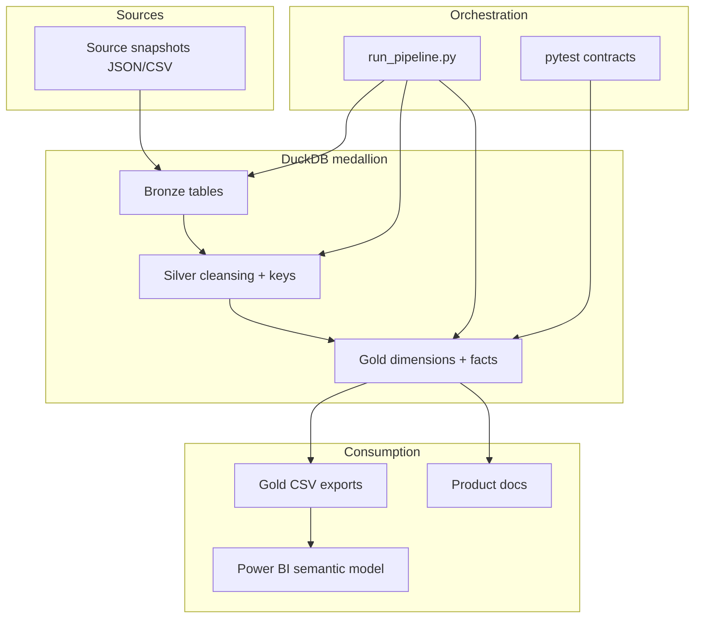

# PulseIQ — Product analytics case study (WS-15)

> **Synthetic disclosure:** PulseIQ is a **fictional B2B SaaS CRM**. All customers, events, and KPIs are **synthetic**. Nothing in this document describes real deployments, revenue, or A/B test outcomes.

## 1. Executive summary

PulseIQ demonstrates how a product team can move from messy operational events to **defensible** activation, engagement, adoption, retention, and segmentation metrics — then use those metrics for prioritisation and roadmap narrative. The work spans medallion-style SQL pipelines in DuckDB, metric contracts, chronology correction, Gold semantic tables, and a Power BI **handoff** (CSV + documented measures; no validated `.pbix` in repo).

As of **2026-07-11**, mature accounts show **strong feature reach** but **0% FR10 as-of activation** among **15** eligible accounts — a tension between *usage* and *activation definition*, not evidence of a “dead” product in the simulation.

## 2. Product context

Fictional multi-tenant CRM for sales teams: dashboards, pipelines, deals, activity logging, automation. **120** accounts, **400** users, **~60k** attributed product events after identity and chronology rules.

## 3. Problem statement

Product and growth teams need answers that survive scrutiny:

- Are new accounts reaching **defined** value (activation), not just logging in?
- Which **features** drive breadth vs one-off trials?
- Do users and accounts **return** on meaningful horizons?
- How do **segments** compare without over-reading tiny samples?

Without chronology-safe facts and explicit **FULL_DATASET vs AS_OF** reporting, synthetic timestamp artefacts can inflate adoption and retention.

## 4. My approach

| Layer | Work |
|-------|------|
| Data engineering | Bronze → Silver → Gold in DuckDB; reproducible `run_pipeline.py` |
| Data quality | Contracts, snapshot validation, quarantine/enrichment labels |
| Metric specification | User vs account grain, FR10 activation, exact-day retention |
| Product analytics | Engagement, adoption, retention, funnel reach, segments |
| Decision intelligence | Opportunities, PRDs, roadmap (WS-14) |
| Portfolio packaging | Power BI exports, measure catalog, case study, README (WS-15) |

## 5. Technical architecture



- **Raw:** Versioned snapshots under `data/source_snapshot/`.
- **Gold:** Chronology-qualified `gold_fact_qualified_product_events` feeds official engagement/adoption/retention.
- **Power BI:** Parameterised folder import; measures documented in `docs/powerbi_measure_catalog.md`.

## 6. Analytics methodology

| Topic | Rule |
|-------|------|
| Grain | Separate **user** and **account** metrics |
| Attribution | SOURCE_VERIFIED / ENRICHED / QUARANTINED; official = qualified chronology |
| Context | `FULL_DATASET` vs `AS_OF 2026-07-11` — never blended on one KPI |
| Cohorts | Retention only on **mature** cohorts; show eligible **n** |
| Activation | FR10 **independent** of general engagement |
| Funnel | **Descriptive reach**, not ordered conversion |

## 7. Key findings (verified)

**Engagement (AS_OF, official):** User/account MAU and DAU show ongoing activity among entities created on or before 2026-07-11; user counts can exceed account counts (multi-user tenants).

**Feature adoption (AS_OF):** Up to **15** account adopters per feature (deal/automation **15**, pipeline/dashboard **14**); **14** accounts with broad (3+) feature use.

**Retention (AS_OF, exact-day):** Account D7/D14 **0 / 15**; user D7 **2 / 56** (~3.6%), user D14 **1 / 53** (~1.9%).

**Activation:** Full-dataset FR10 **21 / 120 (17.5%)**, mean TTV **~9.905 days**. As-of eligible **0 / 15** activated — do **not** label 17.5% as the July 2026 as-of rate.

**Funnel:** High reach on `create_deal` / `move_deal_stage` among **16** eligible accounts; annotation required on all funnel visuals.

**Segments:** SMB **14** vs MID-MARKET **2** eligible as-of — insufficient for strong segment conclusions.

## 8. Product opportunities

| ID | Priority | Theme |
|----|----------|--------|
| OPP-01 | P0 | First-14-day activation path / checklist |
| OPP-02 | P1 | Rolling return measurement + nudges |
| OPP-03 | P1 | Dashboard depth from deal context |
| OPP-04 | P2 | Segment onboarding (deferred) |

**P0 rationale:** Adoption and deal reach are high while FR10 as-of activation is **0%** — clearest actionable gap in the as-of slice.

## 9. Product proposals

1. **Activation milestone guide** — UX checklist mapped to existing events; success = `IsActivatedAsOf` among eligibles without changing FR10 SQL.
2. **Rolling return metric (Phase A)** — analytics definition before product nudges; acknowledges exact-day retention limits.

## 10. Limitations and learning

- Synthetic data and injected chronology anomalies (addressed via qualification).
- Small as-of account cohort (**16** created, **15** mature).
- Exact-day retention ≠ rolling return.
- No experiments or causal claims.
- Missing optional instrumentation (checklist impressions, assignment flags).

## 11. What this project demonstrates

End-to-end **analytics engineering** with **product analyst** judgment: contracts, transparent limitations, and recommendations tied to measurable fields — not dashboard decoration.

## 12. Reproducibility

```powershell
pip install -r requirements.txt
python run_pipeline.py --db-path artifacts/ws15_final.duckdb `
  --export-dir artifacts/ws15_powerbi_exports `
  --as-of-date 2026-07-11 --geography-mode derived-fixture
python scripts/generate_powerbi_export_manifest.py `
  --export-dir artifacts/ws15_powerbi_exports --db-path artifacts/ws15_final.duckdb
python -m pytest tests/ -q
```

See [`docs/RUNBOOK.md`](RUNBOOK.md), [`docs/demo_walkthrough.md`](demo_walkthrough.md), [`docs/powerbi_setup.md`](powerbi_setup.md).
